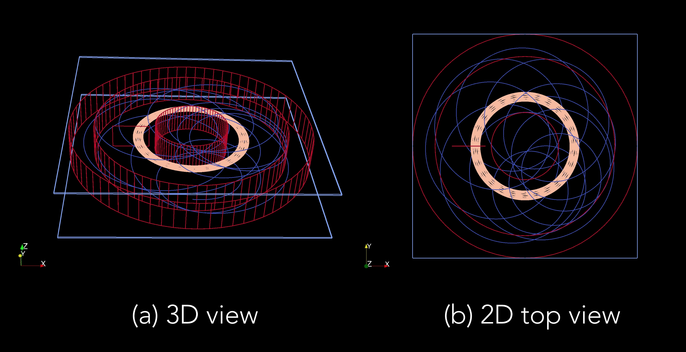
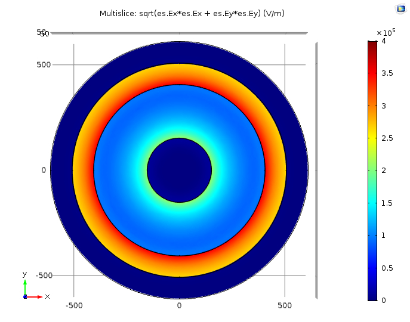

# FS-muonEDM

This is a repository for simulation and analysis codes for the frozen spin muon EDM search experiment. It is based on the musrSim package developed for PSI's Low Energy Muon (LEM) Beamline.

# Pre-requisite:

1) Geant4 installation (tested on geant4.10.03.p03)
2) Visualization plugin (I used Paraview: https://www.paraview.org/download/)

# New Classes:

In addition to all the existing musrSim classes, several ad-hoc classes like the following are added:

1) musrGradientField - This will enable the user to set a gradient magnetic field configuration in the simulation
2) musrRadialField - This will enable the user to set a radial electric field configuration in the simulation
3) run/electrodeEField.txt - This will enable the user to use a radial electric field configuration simulated using COMSOL

# Running the example:

1) Compile FS-muonEDM package
2) Go to the run folder
3) Execute the command `../bin/Darwin-clang/musrSim 101.mac` (for Mac)

# Example event display

The muon track is displayed in cream color and the positron is in blue color.

# Example radial field map

# CHeT tracking and live event display (2026)

The [`chet-tracking/`](chet-tracking/) folder holds CPU/GPU positron tracking for the Cylindrical Helix Tracker (CHeT) of the muEDM Phase I experiment, with a live 3D event display.

* **Live event display:** https://kimsiang.github.io/FS-muonEDM/ (served from `index.html` in this repository root). One simulated decay per second is tracked and helix-fitted in the browser, inside the Phase I apparatus.
* **Python package:** NumPy (CPU) / CuPy (GPU) batched tracking: stereo crossings, triplet seeding, fit-based hit assignment and a joint z / time-of-flight helix fit. See [`chet-tracking/README.md`](chet-tracking/README.md).
* **Blender render:** `chet-tracking/scripts/blender_event_display.py`.

To update the live page after a change, run `python chet-tracking/web/build.py`, then copy `chet-tracking/docs/index.html` to `index.html` in the repository root.
